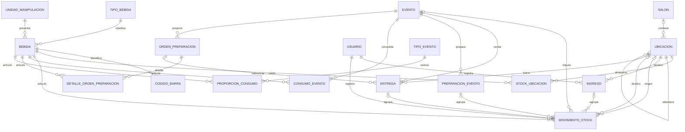

# Relaciones vigentes del módulo B — V9

Este diagrama complementa el diccionario de datos. El PNG `DER_3_bebida.png` es el DER v2 histórico, anterior a V5–V9; no usarlo como esquema vigente. Proveedores y sus dos relaciones se retiraron en V9 por decisión del 19/10/2026. Sus datos históricos se conservan fuera de la base operativa mediante el [procedimiento de resguardo](../eliminacion-proveedores-despliegue.md).

Se muestran las relaciones principales del circuito; el diccionario y las migraciones definen el detalle de columnas, restricciones, motivos, usuarios de apertura/cierre y autorreferencia de correcciones. `movimiento_stock.ingreso_id` sigue vigente y conserva la trazabilidad de ingresos e inventario inicial. Preparación B5-04 es independiente de las órdenes de preparación.
