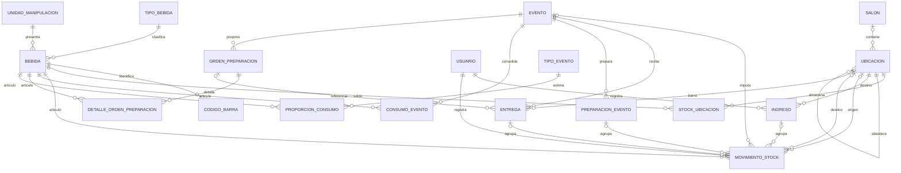

# Relaciones vigentes del módulo B — V9

El [PNG DER_3_bebida.png](DER_3_bebida.png) representa el esquema posterior a V9. Se reconstruyó desde `pg_catalog` de PostgreSQL 17 descartable después de ejecutar Flyway V1–V9 con el backend, porque no había una fuente editable original confiable en el repositorio. La nueva [fuente DOT](DER_3_bebida.dot) conserva las 14 tablas del módulo, sus 90 columnas y las 39 FK salientes, incluidas correcciones, responsables, apertura/cierre y preparación B5-04; las cinco entidades externas aparecen solo con su PK. Se contrastó cada columna, tipo, nulabilidad, PK y FK con esa base. Proveedores y sus relaciones se retiraron en V9; su conservación histórica exige el [procedimiento de resguardo](../eliminacion-proveedores-despliegue.md).

Para regenerar el PNG desde la fuente editable con Graphviz: `dot -Tpng docs/der/DER_3_bebida.dot -o docs/der/DER_3_bebida.png`. No requiere conexión a ninguna base. Al cambiar el esquema, contrastar nuevamente con los metadatos de una base **descartable** migrada antes de actualizar el DOT; no inferir relaciones desde un PNG anterior. La flecha va de FK a PK: extremo lleno para referencia obligatoria y círculo para nullable; cada padre admite cero o múltiples hijos salvo restricciones únicas del esquema. PK compuestas y FK se indican en las filas. El diagrama no sustituye checks, índices únicos, triggers ni las migraciones.

El siguiente resumen Mermaid muestra solo las relaciones principales para lectura rápida:

Se muestran las relaciones principales del circuito; el diccionario y las migraciones definen el detalle de columnas, restricciones, motivos, usuarios de apertura/cierre y autorreferencia de correcciones. `movimiento_stock.ingreso_id` sigue vigente y conserva la trazabilidad de ingresos e inventario inicial. Preparación B5-04 es independiente de las órdenes de preparación.
