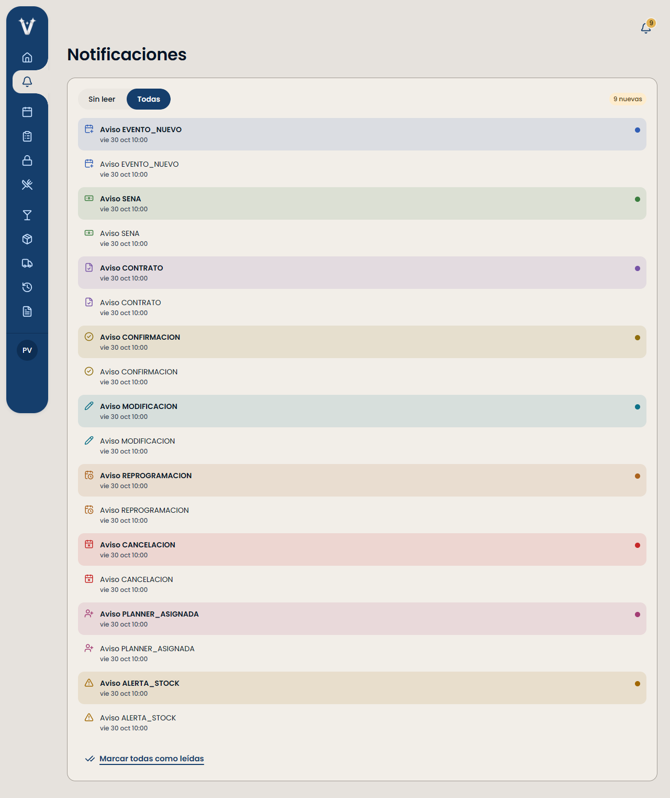
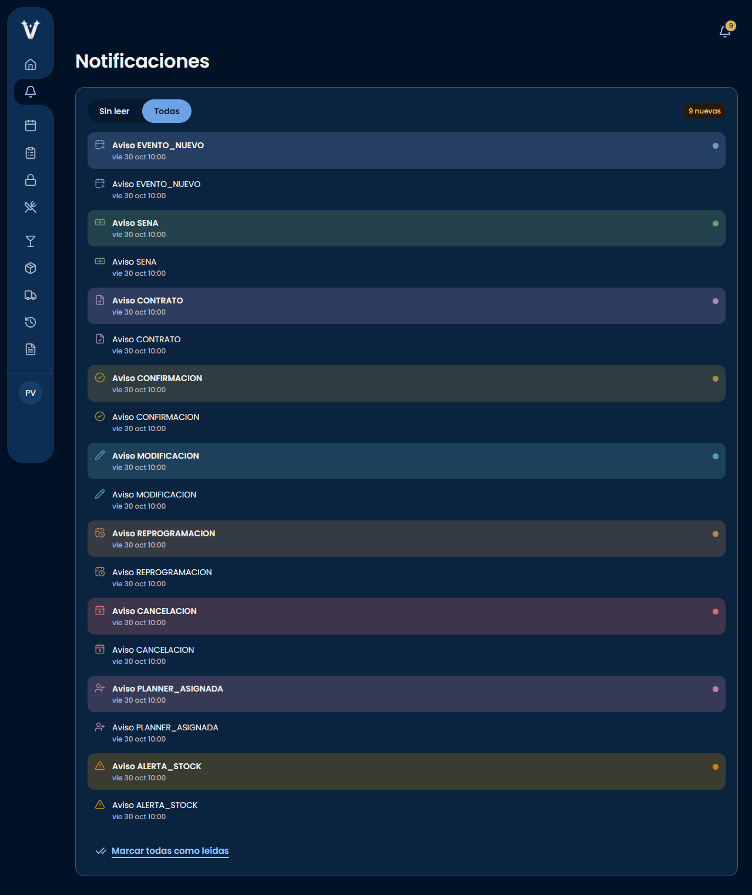

# M-08: evidencia para revisión de Albert

Base: #52 `0f5eb45`. Ese commit ya retiró `package-lock.json` de raíz y la auditoría; no se repiten las eliminaciones. `frontend/package-lock.json` no cambia. La auditoría histórica se recuperó sin BOM en #64, sobre main `f94fd73`; hallazgos Alta #61, #62 y #63, tras revisar los issues abiertos/cerrados.

## Accesibilidad

Se conserva la paleta del HEAD de #52, que ya define variantes por tema. El navegador comprueba el color calculado del SVG contra el token, `stroke: currentColor`, fondo efectivo, hover y estados leído/sin leer. Se aplica luminancia relativa sRGB y `(Lmayor + 0.05)/(Lmenor + 0.05)`, mínimo 3:1, sin redondear antes de comparar.

| Tema | Mínimo medido por Chrome, escritorio y teléfono |
|---|---:|
| Claro | 3.513:1 |
| Oscuro | 3.501:1 |
| Automático con SO oscuro | 3.501:1 |

Los nueve tipos existentes conservan mensajes e íconos con trazos distintos. El estado sin leer tiene punto, negrita y texto accesible. No se afirma que los colores cálidos sean distinguibles por sí solos y no se ejecutó un simulador dedicado de daltonismo.

Pruebas: `frontend/src/features/notificaciones/contraste.test.ts` (22 casos sobre los tokens CSS reales y superficies canvas, surface, raised, sunken y mezcla sin leer) y `frontend/e2e/notificaciones-colores.spec.ts` (6 escenarios, API simulada). El selector de Calendar se verifica con un fixture CSS explícito, no con funcionalidad Calendar incorporada a esta rama.

Capturas en `m-08-capturas/`: claro, oscuro y sistema, escritorio/teléfono. Solo para la captura se expande la lista del fixture, después de las aserciones, para mostrar todos los tipos; la aplicación conserva su scroll. Los valores individuales medidos están en [contrastes.json](m-08-capturas/contrastes.json).

## Compatibilidad

Se inspeccionó `docs/compatibilidad/m-06-pr52.patch` de #59. Se anticipan sus dos cambios mínimos: entrada `CALENDAR_PENDIENTE` en COLOR y selector con `--warning`, que tiene variante por tema. La unión `TipoNotificacion | 'CALENDAR_PENDIENTE'` permite compilar antes y después de M-06 sin importar su API. No cambia Google Calendar ni la navegación de avisos. No reaplicar el parche después de incorporar esta corrección.

| Referencia vigente al verificar | Árbol combinado con la corrección | TypeScript |
|---|---|---|
| main `f94fd73` | Sin conflictos | Correcto |
| #51 `6185c08` | Sin conflictos | Correcto |
| #59 `88bc0db` | Sin conflictos | Correcto |
| #49 `d136cc6` | Sin conflictos | Correcto |
| #60 `9bcff1a` | Sin conflictos | Correcto |

Son copias descartables de combinaciones por pares; no se incorporan sus commits ni se ejecutan suites completas en cada combinación. Repetir si cambia cualquier HEAD.

## Validación y límites

- Notificaciones: 18/18. Contraste: 22/22. E2E final Chrome: 6/6, cero omisiones, con API simulada. No sustituye aceptación contra backend desplegado.
- ESLint, TypeScript y build de producción correctos; lockfile legítimo intacto y `git diff --check` correcto.
- Suite frontend completa local: los primeros intentos con forks quedaron sin resumen y se interrumpieron; el intento con threads sigue pendiente al preparar este documento. No se contabilizan como aprobados. El resultado definitivo se registra en la descripción del PR.
- Primeros E2E: fallo al iniciar Edge en sandbox y conexión inaccesible entre entornos; repetición con Chrome y Vite en el mismo entorno correcta. El test de contraste necesitó corregir su importación de CSS/Node para compilar; la versión final pasó.
- CI: consultar las ejecuciones de los HEAD finales enlazadas en las descripciones de #64 y #65. Al preparar esta evidencia, Backend y Frontend estaban en cola sin runner asignado; no se consideran aprobados.

Mantener ambos PR Draft. Propuesta: revisar e integrar primero #65 en la rama del #52 por el procedimiento humano del equipo, actualizar con main y repetir CI del HEAD resultante; coordinar M-06 sin reaplicar el parche. Solicitar nueva revisión de Albert cuando los checks estén verdes. Su CHANGES_REQUESTED no se resuelve automáticamente. #64 se revisa independientemente. No se modifica main ni se aprueba, fusiona o cierra ningún PR.
